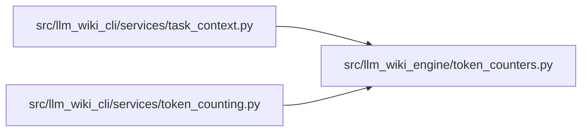

# token_counters Module

**Path:** `src/llm_wiki_engine/token_counters.py`

## Description

Token counters for budgeted output.

A budget is accounted with a :class:`TokenCounter`. The engine supplies
:class:`EstimatedCounter`; an exact counter (for example one backed by a
local tokenizer) is supplied by the host application and passed in.

## Imports

| Source | Symbols |
|--------|---------|
| `__future__` | `annotations` |
| `typing` | `Protocol` |

## Local dependency map

<!-- Auto-generated local dependency summary. Do not edit by hand. -->

### Internal neighbors

| Direction | Module |
|---|---|
| Inbound | [task_context](../modules/task_context.md) |
| Inbound | [token_counting](../modules/token_counting.md) |

## Classes

| Class | Line | Bases | Description |
|-------|------|-------|-------------|
| [TokenCounter](../entities/TokenCounter.md) | 13 | `Protocol` | — |
| [EstimatedCounter](../entities/EstimatedCounter.md) | 20 | — | — |
