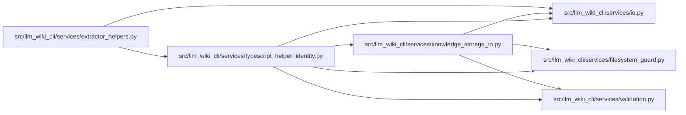

# typescript_helper_identity Module

**Path:** `src/llm_wiki_cli/services/typescript_helper_identity.py`

## Description

Bounded observations of the complete prepared TypeScript dependency tree.

Fingerprints the complete prepared node_modules tree, including sibling and
nested dependencies. Guarded reads reject links, reparse points, hard links,
foreign paths and observed mutation; entry, total-byte, per-file, path-depth
and receipt limits stay explicit. This module observes custody and validates
receipts without preparing tools, migrating caches or executing target source.

## Imports

| Source | Symbols |
|--------|---------|
| `.filesystem_guard` | `fresh_no_follow_stat` |
| `.io` | `first_unsafe_path_component` |
| `.knowledge_storage_io` | `read_guarded` |
| `.validation` | `is_portable_relative_path` |
| `__future__` | `annotations` |
| `hashlib` | `hashlib` |
| `json` | `json` |
| `os` | `os` |
| `pathlib` | `Path` |
| `stat` | `stat` |

## Local dependency map

<!-- Auto-generated local dependency summary. Do not edit by hand. -->

### Internal neighbors

| Direction | Module |
|---|---|
| Inbound | [extractor_helpers](../modules/extractor_helpers.md) |
| Outbound | [filesystem_guard](../modules/filesystem_guard.md) |
| Outbound | [io](../modules/io.md) |
| Outbound | [knowledge_storage_io](../modules/knowledge_storage_io.md) |
| Outbound | [validation](../modules/validation.md) |

## Functions

| Function | Signature | Decorators | Description |
|----------|-----------|------------|-------------|
| `read_receipt` | `(path: Path)` | — | Read bounded regular receipt bytes without following redirects. |
| `_identity` | `(value)` | — | — |
| `_validate_dependency_path` | `(relative: str) -> None` | — | Apply the portable-path contract and dependency traversal depth bound. |
| `_snapshot` | `(root)` | — | — |
| `dependency_fingerprint` | `(node_modules: Path) -> str` | — | Hash all paths and regular bytes; refuse unsafe, oversized or changing trees. |
| `execution_source_fingerprint` | `(root: Path, names) -> str` | — | Retain the existing labeled source contract using guarded bounded reads. |