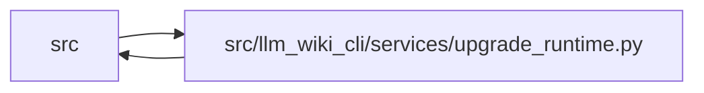

# upgrade_runtime Module

**Path:** `src/llm_wiki_cli/services/upgrade_runtime.py`

## Description

llm-wiki upgrade — refresh all framework-managed artifacts in place.

Replaces the uninstall → init cycle with a single idempotent
command that:
1. Removes unmodified legacy LLM Wiki Git hooks
2. Replaces the agent constraint block with the latest version
3. Ensures wiki directory structure is complete
4. Optionally switches agents

Normal upgrade selects current workflow and storage contracts for the project, preserving authored pages and existing governance with complete recovery preimages. It handles supported legacy canonical layouts as an owning operation and refuses damaged authority. Source roots, selection, helper prerequisites and optional behavior remain explicit project coordinates; agents do not select schema versions.

Project upgrade refreshes owned recovery instructions and preserves configured
skills opt-out, source selection and user-authored text outside the managed block.
An older default installation receives the current reference or inline recipe.
Neither refreshed instructions nor storage upgrade alone clears captured unknown
evidence: diagnosis and an authorized owning writer retain distinct roles.

## Imports

| Source | Symbols |
|--------|---------|
| `..config` | `AGENT_CHOICES`, `AgentConfigInspection`, `AgentConfigState`, `CLI_AGENTS`, `DEFAULT_WIKI_DIR`, `PathValidationError`, `config_requires_manual_recovery`, `get_agent_config_path`, `inspect_config`, `require_committed_config`, `require_config_inspection_unchanged`, `require_safe_config_path`, `validate_path`, `write_config` |
| `.current_contracts` | `CURRENT_KNOWLEDGE_FORMAT`, `current_contract_defaults`, `upgrade_current_knowledge` |
| `.legacy_hooks` | `LegacyHookError`, `inspect_legacy_hooks`, `remove_legacy_hooks` |
| `.rendering_lifecycle` | `reference_recovery_command`, `select_render_profile` |
| `.schema` | `SCHEMA_FILENAMES`, `ManagedSchemaBlockError`, `ManagedSchemaBlockState`, `ManagedSchemaPathError`, `SchemaRenderProfile`, `build_schema_content`, `build_upgraded_schema_content`, `classify_managed_schema_block`, `decode_managed_document_bytes`, `encode_managed_document_text`, `installed_skill_block_contents`, `require_managed_schema_profile`, `require_replaceable_managed_schema`, `require_safe_schema_path`, `strip_wiki_block` |
| `.skills` | `REFERENCE_SKILL_ID`, `ReferenceSkillState`, `_provision_reference_skill_guarded`, `skills_install_dir`, `verify_reference_skill` |
| `.sync_runtime` | `run_request` |
| `.sync_service` | `SyncRequest` |
| `.upgrade_service` | `UpgradeError`, `UpgradeOutcome`, `UpgradeRequest`, `UpgradeRequestError` |
| `.wiki_lifecycle` | `WikiScaffoldPathError`, `provision_wiki_scaffold`, `require_safe_wiki_scaffold` |
| `__future__` | `annotations` |
| `dataclasses` | `dataclass` |
| `llm_wiki_engine.filesystem_guard` | `atomic_write_guarded_bytes`, `ensure_guarded_directory`, `guarded_tree_manifest`, `remove_guarded_tree`, `unlink_guarded_bytes`, `windows_object_identity` |
| `llm_wiki_engine.historical_sources` | `bound_records` |
| `llm_wiki_engine.host` | `current_host`, `emit`, `recording_errors` |
| `llm_wiki_engine.knowledge_evidence` | `formatted_json_bytes` |
| `llm_wiki_engine.source_selection` | `SourceSelectionError`, `resolve_source_selection` |
| `llm_wiki_engine.sync_manifest` | `SyncManifest` |
| `os` | `os` |
| `pathlib` | `Path` |
| `shutil` | `shutil` |
| `typing` | `Callable` |

## Local dependency map

<!-- Auto-generated local dependency summary. Do not edit by hand. -->

> Module-level dependencies exceed the generated-diagram limits, so the diagram and table below group them by top-level package. Counts report the number of module neighbors in each package.

### Internal neighbors

| Direction | Module |
|---|---|
| Inbound | `src` (1) |
| Outbound | `src` (16) |

> All 17 module neighbor(s) are summarized by package because the module-level view exceeds the 12-node limit.

## Classes

| Class | Line | Bases | Description |
|-------|------|-------|-------------|
| [StructureUpgradeResult](../entities/StructureUpgradeResult.md) | 92 | — | Paths created while refreshing the framework-owned wiki structure. |
| [SchemaCleanupReceipt](../entities/SchemaCleanupReceipt.md) | 105 | — | Reversible source-schema mutation held until cleanup is committed. |
| [ReferenceCleanupOutcome](../entities/ReferenceCleanupOutcome.md) | 114 | — | Whether source-reference cleanup completed and schema must roll back. |
| [SourceCleanupOutcome](../entities/SourceCleanupOutcome.md) | 123 | — | Result of one recorded-source cleanup transaction. |
| [UpgradeAborted](../entities/UpgradeAborted.md) | 610 | `SystemExit` | Upgrade stopped with an exit status; ``message`` says why when no error line did. |

## Functions

| Function | Signature | Decorators | Description |
|----------|-----------|------------|-------------|
| `_decode_schema_bytes` | `(data: bytes) -> str` | — | Decode one immutable schema snapshot without rewriting surrounding bytes. |
| `_require_replaceable_schema_path` | `(path: str \| Path) -> tuple[Path, str, bytes \| None]` | — | Read one coherent schema snapshot and preflight its managed markers. |
| `_resolve_agent` | `(agent: str \| None, wiki_dir: str, inspection: AgentConfigInspection \| None = None) -> str` | — | Resolve agent: requested agent (CLI --agent) > persisted config > error. |
| `_upgrade_schema` | `(agent: str, wiki_dir: str, *, render_profile: SchemaRenderProfile, quality_hints: bool = True, issue_reporting: bool = False, source_selection: str \| Path \| None = None) -> tuple[str, bytes \| None]` | — | Atomically write the target schema without cleaning any source path. |
| `_clean_old_schema` | `(old_agent: str \| None, new_agent: str, *, pre_mutation_check: Callable[[], None] \| None = None) -> SchemaCleanupReceipt \| None` | — | Clean the source schema and return a receipt for guarded rollback. |
| `_restore_old_schema` | `(receipt: SchemaCleanupReceipt \| None) -> None` | — | Restore an already-cleaned source schema without overwriting new bytes. |
| `_preflight_cleanup_agent` | `(source_agent: str \| None, active_agent: str) -> None` | — | Reject an unsafe or malformed recorded switch source before mutation. |
| `_target_cleanup_is_ready` | `(agent: str, *, target_profile: SchemaRenderProfile, target_schema_bytes: bytes \| None, require_target_reference: bool) -> bool` | — | Revalidate the committed target immediately before source destruction. |
| `_cleanup_config_is_current` | `(wiki_dir: str, committed_config: dict) -> bool` | — | Keep destructive cleanup bound to the exact pending config commit. |
| `_cleanup_recorded_source` | `(active_agent: str, source_agent: str \| None, *, wiki_dir: str, committed_config: dict, remove_references: bool, target_profile: SchemaRenderProfile, target_schema_bytes: bytes \| None, require_target_reference: bool) -> SourceCleanupOutcome` | — | Clean only the source explicitly recorded by the switch transaction. |
| `_migrate_reference_skill` | `(old_agent: str \| None, new_agent: str, *, target_current: bool, target_profile: SchemaRenderProfile, target_schema_bytes: bytes \| None, pre_mutation_check: Callable[[], None] \| None = None) -> ReferenceCleanupOutcome` | — | Remove only a verified-current source after a usable target commit. |
| `_upgrade_dirs` | `(wiki_dir: str) -> StructureUpgradeResult` | — | Ensure all standard wiki subdirectories and tracking files exist. |
| `_legacy_seed_sync_request` | `(src_dir, wiki_dir, *, helper_cache_dir = None, source_selection = None)` | — | The forced, plugin-free current-format sync that seeds a legacy wiki. |
| `_seed_legacy_for_current_defaults` | `(src_dir, wiki_dir, *, helper_cache_dir = None, source_selection = None)` | — | Keep legacy owning-command dispatch out of the storage service layer. |
| `upgrade_request_from_args` | `(args) -> UpgradeRequest` | — | Translate parsed ``upgrade`` arguments into an :class:`UpgradeRequest`. |
| `run` | `(args)` | — | — |
| `execute_upgrade` | `(request: UpgradeRequest) -> UpgradeOutcome` | — | Run one upgrade without argparse or process exits. |
| `run_request` | `(request: UpgradeRequest) -> UpgradeOutcome` | — | Run one upgrade for a command: output goes to the host, stops raise UpgradeAborted. |
