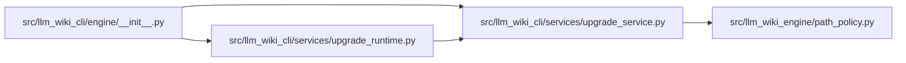

# upgrade_service Module

**Path:** `src/llm_wiki_cli/services/upgrade_service.py`

## Description

Typed upgrade inputs and results shared by the CLI, the Python API and engines.

Importing this module is cheap; the upgrade lives in
:mod:`llm_wiki_cli.services.upgrade_runtime` and is loaded on first use.

## Imports

| Source | Symbols |
|--------|---------|
| `__future__` | `annotations` |
| `collections.abc` | `Sequence` |
| `dataclasses` | `dataclass` |
| `llm_wiki_engine.path_policy` | `DEFAULT_WIKI_DIR` |
| `pathlib` | `Path` |
| `typing` | `Any`, `Literal` |

## Local dependency map

<!-- Auto-generated local dependency summary. Do not edit by hand. -->

### Internal neighbors

| Direction | Module |
|---|---|
| Inbound | [engine___init__](../modules/engine___init__.md) |
| Inbound | [upgrade_runtime](../modules/upgrade_runtime.md) |
| Outbound | [path_policy](../modules/path_policy.md) |

## Classes

| Class | Kind | Line | Bases / Target | Description |
|-------|------|------|----------------|-------------|
| [UpgradeStatus](../entities/UpgradeStatus.md) | Type alias | 16 | `Literal['complete', 'source-cleanup-pending']` | — |
| [UpgradeRequest](../entities/UpgradeRequest.md) | Class | 20 | — | One in-place refresh of the managed agent schema, skills and wiki layout. |
| [UpgradeOutcome](../entities/UpgradeOutcome.md) | Class | 42 | — | What one upgrade did; human-readable progress went to the host streams. |
| [UpgradeError](../entities/UpgradeError.md) | Class | 71 | `Exception` | Upgrade stopped; ``exit_code`` is the status the CLI would exit with. |
| [UpgradeRequestError](../entities/UpgradeRequestError.md) | Class | 79 | `UpgradeError` | The request names a path the workspace policy rejects. |
