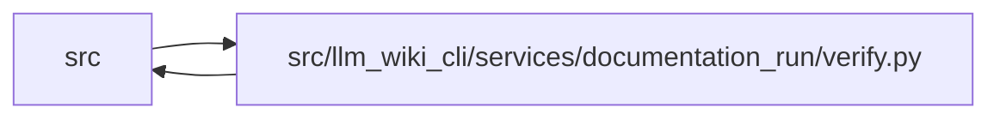

# verify Module

**Path:** `src/llm_wiki_cli/services/documentation_run/verify.py`

## Description

Documentation-run verify services.

## Imports

| Source | Symbols |
|--------|---------|
| `.` | `publication` |
| `..knowledge_consumption` | `load_knowledge_read_view` |
| `..knowledge_projection` | `project_knowledge` |
| `.contracts` | `*` |
| `.dependencies` | `*` |
| `.integrity` | `*` |
| `.record` | `*` |
| `.refresh` | `*` |
| `.schema` | `*` |
| `.workspace` | `*` |
| `__future__` | `annotations` |

## Local dependency map

<!-- Auto-generated local dependency summary. Do not edit by hand. -->

> Module-level dependencies exceed the generated-diagram limits, so the diagram and table below group them by top-level package. Counts report the number of module neighbors in each package.

### Internal neighbors

| Direction | Module |
|---|---|
| Inbound | `src` (2) |
| Outbound | `src` (10) |

> All 12 module neighbor(s) are summarized by package because the module-level view exceeds the 12-node limit.

## Functions

| Function | Signature | Decorators | Description |
|----------|-----------|------------|-------------|
| `verify_documentation_run` | `(workspace: str \| Path, *, advance: bool = True) -> DocumentationVerificationReport` | — | Run deterministic lifecycle checks and optionally advance review state. |
| `_documentation_projection_policy` | `(run: DocumentationRun) -> tuple[str, str \| None]` | — | — |
| `_assert_documentation_export_projection_policy` | `(run: DocumentationRun, *, knowledge_mode: str \| None, knowledge_public_repository_identity: str \| None) -> tuple[str, str \| None]` | — | — |
| `_load_documentation_knowledge_projection` | `(wiki_root: Path, *, knowledge_mode: str, knowledge_public_repository_identity: str \| None)` | — | — |
| `_documentation_projection_evidence` | `(*, knowledge_mode: str, knowledge_public_repository_identity: str \| None, projection) -> dict[str, Any]` | — | — |
