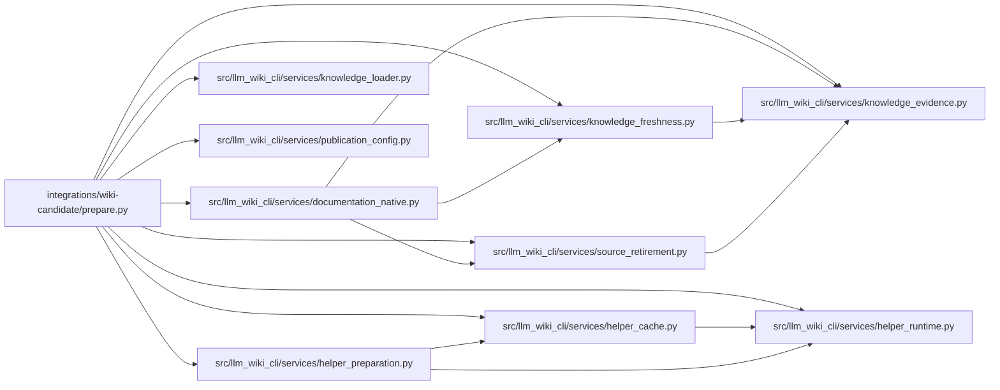

# prepare Module

**Path:** `integrations/wiki-candidate/prepare.py`

## Description

Prepare the selected helpers and check a consumer's existing native evidence.

## Imports

| Source | Symbols |
|--------|---------|
| `__future__` | `annotations` |
| `argparse` | `argparse` |
| `hashlib` | `hashlib` |
| `json` | `json` |
| `llm_wiki_cli.services.documentation_native` | `evaluate_documentation_native_freshness` |
| `llm_wiki_cli.services.helper_cache` | `ensure_helper` |
| `llm_wiki_cli.services.helper_preparation` | `selected_helper_languages` |
| `llm_wiki_cli.services.helper_runtime` | `helper_operation` |
| `llm_wiki_cli.services.knowledge_evidence` | `hash_json` |
| `llm_wiki_cli.services.knowledge_freshness` | `REASON_CONCEPT_OBSERVATION_CHANGED` |
| `llm_wiki_cli.services.knowledge_loader` | `load_knowledge_state` |
| `llm_wiki_cli.services.publication_config` | `load_publication_config`, `publication_path` |
| `llm_wiki_cli.services.source_retirement` | `retired_entity_mappings` |
| `pathlib` | `Path` |
| `subprocess` | `subprocess` |
| `sys` | `sys` |

## Local dependency map

<!-- Auto-generated local dependency summary. Do not edit by hand. -->

### Internal neighbors

| Direction | Module |
|---|---|
| Outbound | [documentation_native](../modules/documentation_native.md) |
| Outbound | [helper_cache](../modules/helper_cache.md) |
| Outbound | [helper_preparation](../modules/helper_preparation.md) |
| Outbound | [helper_runtime](../modules/helper_runtime.md) |
| Outbound | [knowledge_evidence](../modules/knowledge_evidence.md) |
| Outbound | [knowledge_freshness](../modules/knowledge_freshness.md) |
| Outbound | [knowledge_loader](../modules/knowledge_loader.md) |
| Outbound | [publication_config](../modules/publication_config.md) |
| Outbound | [source_retirement](../modules/source_retirement.md) |

## Functions

| Function | Signature | Decorators | Description |
|----------|-----------|------------|-------------|
| `_write` | `(path: Path, document: dict) -> None` | — | — |
| `prepare` | `(mode: str, consumer: Path, config_path: str, source_dir: str, evidence: Path, cache: Path) -> None` | — | — |
