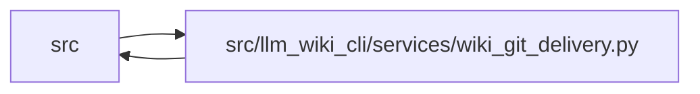

# wiki_git_delivery Module

**Path:** `src/llm_wiki_cli/services/wiki_git_delivery.py`

## Description

Read-only completeness of an owned native snapshot under effective Git policy.

## Imports

| Source | Symbols |
|--------|---------|
| `.team` | `TeamConfigError`, `load_team_config`, `team_config_path`, `wiki_ownership`, `TeamConfigError`, `load_team_config`, `wiki_ownership` |
| `.wiki_git_policy` | `_git_environment`, `classify_wiki_git_policy` |
| `__future__` | `annotations` |
| `collections.abc` | `Mapping` |
| `hashlib` | `hashlib` |
| `llm_wiki_engine.io` | `decode_markdown_bytes` |
| `llm_wiki_engine.knowledge_governance` | `GOVERNANCE_FILENAME` |
| `llm_wiki_engine.knowledge_storage` | `KnowledgeStorageError` |
| `llm_wiki_engine.knowledge_storage_diagnostics` | `_git` |
| `llm_wiki_engine.knowledge_storage_io` | `_absolute_path` |
| `llm_wiki_engine.knowledge_storage_lifecycle` | `_committed_inputs` |
| `llm_wiki_engine.maintenance_protocol` | `ADOPTION_FILENAME` |
| `pathlib` | `Path` |
| `re` | `re` |
| `typing` | `Any` |

## Local dependency map

<!-- Auto-generated local dependency summary. Do not edit by hand. -->

> Module-level dependencies exceed the generated-diagram limits, so the diagram and table below group them by top-level package. Counts report the number of module neighbors in each package.

### Internal neighbors

| Direction | Module |
|---|---|
| Inbound | `src` (3) |
| Outbound | `src` (9) |

> All 12 module neighbor(s) are summarized by package because the module-level view exceeds the 12-node limit.

## Functions

| Function | Signature | Decorators | Description |
|----------|-----------|------------|-------------|
| `_command` | `(root: Path, arguments: list[str], *, data: bytes \| None = None, maximum: int = MAX_GIT_METADATA_BYTES) -> tuple[int, bytes]` | — | — |
| `_ignored` | `(root: Path, paths: list[str]) -> set[str]` | — | — |
| `_index` | `(root: Path) -> tuple[bytes, dict[bytes, list[tuple[bytes, bytes, bytes]]]]` | — | — |
| `_blobs` | `(root: Path, identities: set[bytes]) -> dict[bytes, bytes]` | — | — |
| `_require_absent_authority` | `(root: Path, paths: set[str]) -> None` | — | — |
| `_staged` | `(root: Path, expected: Mapping[str, bytes], markdown: set[str], absent: set[str])` | — | — |
| `inspect_wiki_git_delivery` | `(wiki_dir: str \| Path, *, staged: bool = False) -> dict[str, Any]` | — | Check every required native file; an explicit staged check gates handoff. |
| `current_branch` | `(root: str \| Path = '.') -> str \| None` | — | Return the checked-out branch name, or ``None`` when HEAD is detached. |
| `ownership_write_refusal` | `(root: str \| Path = '.') -> str \| None` | — | Explain why this checkout may not write generated wiki state. |
| `inspect_branch_wiki_changes` | `(wiki_dir: str \| Path, *, base: str, branch: str \| None = None, root: str \| Path = '.') -> dict[str, Any]` | — | Report generated wiki paths a branch changed since ``base``. |
