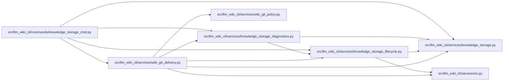

# wiki_git_delivery Module

**Path:** `src/llm_wiki_cli/services/wiki_git_delivery.py`

## Description

Read-only completeness of an owned native snapshot under effective Git policy.

## Imports

| Source | Symbols |
|--------|---------|
| `.io` | `decode_markdown_bytes` |
| `.knowledge_storage` | `KnowledgeStorageError` |
| `.knowledge_storage_diagnostics` | `_git` |
| `.knowledge_storage_lifecycle` | `_committed_inputs` |
| `.wiki_git_policy` | `_git_environment`, `classify_wiki_git_policy` |
| `__future__` | `annotations` |
| `collections.abc` | `Mapping` |
| `hashlib` | `hashlib` |
| `pathlib` | `Path` |
| `re` | `re` |
| `typing` | `Any` |

## Local dependency map

<!-- Auto-generated local dependency summary. Do not edit by hand. -->

### Internal neighbors

| Direction | Module |
|---|---|
| Inbound | [knowledge_storage_cmd](../modules/knowledge_storage_cmd.md) |
| Outbound | [io](../modules/io.md) |
| Outbound | [knowledge_storage](../modules/knowledge_storage.md) |
| Outbound | [knowledge_storage_diagnostics](../modules/knowledge_storage_diagnostics.md) |
| Outbound | [knowledge_storage_lifecycle](../modules/knowledge_storage_lifecycle.md) |
| Outbound | [wiki_git_policy](../modules/wiki_git_policy.md) |

## Functions

| Function | Signature | Decorators | Description |
|----------|-----------|------------|-------------|
| `_command` | `(root: Path, arguments: list[str], *, data: bytes \| None = None, maximum: int = MAX_GIT_METADATA_BYTES) -> tuple[int, bytes]` | — | — |
| `_ignored` | `(root: Path, paths: list[str]) -> set[str]` | — | — |
| `_index` | `(root: Path) -> tuple[bytes, dict[bytes, list[tuple[bytes, bytes, bytes]]]]` | — | — |
| `_blobs` | `(root: Path, identities: set[bytes]) -> dict[bytes, bytes]` | — | — |
| `_staged` | `(root: Path, expected: Mapping[str, bytes], markdown: set[str])` | — | — |
| `inspect_wiki_git_delivery` | `(wiki_dir: str \| Path, *, staged: bool = False) -> dict[str, Any]` | — | Check every required native file; an explicit staged check gates handoff. |
