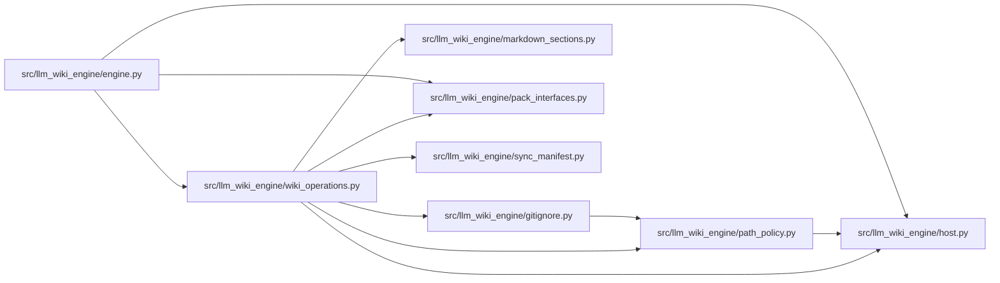

# wiki_operations Module

**Path:** `src/llm_wiki_engine/wiki_operations.py`

## Description

Bootstrap, sync and lint a wiki through a domain pack alone.

These use cases need nothing but the active
:class:`~.pack_interfaces.DomainPack`: its classifier picks the sources, its
extractors (in-process ``"module:attribute"`` entry points) read them, and its
page namer and renderer name and write the pages. Pages start from a generic
built-in Markdown that the renderer may adjust. Each page's ``Description``
section is reviewed text: sync keeps what people wrote there.

A wiki written here holds module and entity pages, ``index.md``, ``log.md``
and the sync manifest. Applications with richer analysis (call graphs,
infrastructure, knowledge bundles) run their own use cases instead.

## Imports

| Source | Symbols |
|--------|---------|
| `.gitignore` | `build_gitignore_matcher` |
| `.host` | `current_host`, `emit` |
| `.markdown_sections` | `replace_section_body`, `section_body` |
| `.pack_interfaces` | `DomainPack`, `EntityPageRequest`, `ModulePageRequest`, `active_pack` |
| `.path_policy` | `EXCLUDED_DIRS` |
| `.sync_manifest` | `MANIFEST_FILENAME`, `SyncManifest`, `SyncManifestError` |
| `__future__` | `annotations` |
| `collections.abc` | `Iterable`, `Mapping` |
| `dataclasses` | `dataclass`, `field` |
| `hashlib` | `hashlib` |
| `importlib` | `importlib` |
| `os` | `os` |
| `pathlib` | `Path`, `PurePath` |
| `re` | `re` |
| `tempfile` | `tempfile` |
| `typing` | `Any` |

## Local dependency map

<!-- Auto-generated local dependency summary. Do not edit by hand. -->

### Internal neighbors

| Direction | Module |
|---|---|
| Inbound | [engine](../modules/engine.md) |
| Outbound | [gitignore](../modules/gitignore.md) |
| Outbound | [host](../modules/host.md) |
| Outbound | [markdown_sections](../modules/markdown_sections.md) |
| Outbound | [pack_interfaces](../modules/pack_interfaces.md) |
| Outbound | [path_policy](../modules/path_policy.md) |
| Outbound | [sync_manifest](../modules/sync_manifest.md) |

## Classes

| Class | Line | Bases | Description |
|-------|------|-------|-------------|
| [WikiOperationError](../entities/WikiOperationError.md) | 39 | `Exception` | A wiki use case cannot complete; the message says why. |
| [BootstrapRequest](../entities/wiki_operations_BootstrapRequest.md) | 44 | — | Create a wiki at ``wiki_root`` from the sources under ``source_root``. |
| [SyncRequest](../entities/wiki_operations_SyncRequest.md) | 52 | — | Bring the wiki at ``wiki_root`` up to date with ``source_root``. |
| [LintRequest](../entities/wiki_operations_LintRequest.md) | 60 | — | Check the wiki at ``wiki_root`` against ``source_root``. |
| [BootstrapResult](../entities/wiki_operations_BootstrapResult.md) | 68 | — | — |
| [SyncResult](../entities/wiki_operations_SyncResult.md) | 77 | — | — |
| [LintIssue](../entities/wiki_operations_LintIssue.md) | 87 | — | — |
| [LintReport](../entities/wiki_operations_LintReport.md) | 94 | — | — |

## Functions

| Function | Signature | Decorators | Description |
|----------|-----------|------------|-------------|
| `_pack` | `() -> DomainPack` | — | — |
| `_roots` | `(request: Any) -> tuple[Path, Path]` | — | — |
| `_classified_sources` | `(source: Path, wiki: Path, pack: DomainPack) -> dict[str, str]` | — | Return ``{relative path: source kind}`` for every source the pack accepts. |
| `_extract` | `(source: Path, sources: Mapping[str, str], pack: DomainPack) -> dict[str, dict]` | — | — |
| `_file_hash` | `(path: Path) -> str` | — | — |
| `_content_hashes` | `(source: Path, inventory: Mapping[str, Any]) -> dict[str, str]` | — | — |
| `_cell` | `(value: object) -> str` | — | — |
| `_module_markdown` | `(page: str, source_path: str, data: Mapping[str, Any], entity_links: Mapping[str, str]) -> str` | — | — |
| `_entity_markdown` | `(entity: Mapping[str, Any], source_path: str, module_page: str \| None) -> str` | — | — |
| `_render` | `(inventory: Mapping[str, dict], pack: DomainPack) -> tuple[dict[str, str], dict, dict]` | — | Return ``{wiki-relative page path: Markdown}``, the module and entity page maps. |
| `_rendered_entity` | `(pack: DomainPack, entity: Mapping[str, Any], source_path: str, module_page: str, module_pages: Mapping[str, str]) -> str` | — | — |
| `_text` | `(markdown: object) -> str` | — | — |
| `_index_markdown` | `(pages: Iterable[str]) -> str` | — | — |
| `_keep_reviewed_text` | `(new: str, old: str \| None) -> str` | — | — |
| `_write` | `(path: Path, text: str) -> None` | — | — |
| `_append_log` | `(wiki: Path, line: str) -> None` | — | — |
| `_manifest` | `(inventory, source: Path, module_pages, entity_pages, hashes) -> SyncManifest` | — | — |
| `bootstrap` | `(request: BootstrapRequest) -> BootstrapResult` | — | Write a new wiki; refuses a wiki that already has a manifest. |
| `_owned_pages` | `(manifest: SyncManifest) -> set[str]` | — | — |
| `sync` | `(request: SyncRequest) -> SyncResult` | — | Rewrite pages whose sources changed, keep reviewed text, retire removed pages. |
| `lint` | `(request: LintRequest) -> LintReport` | — | Report missing, unowned, stale and broken-link pages; never writes. |
| `_broken_links` | `(wiki: Path, page: str) -> list[LintIssue]` | — | — |
