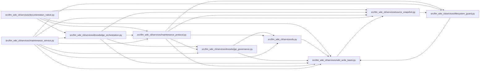

# wiki_write_basis Module

**Path:** `src/llm_wiki_cli/services/wiki_write_basis.py`

## Description

Operation-local compare-and-swap hooks for adopted wiki writes.

## Imports

| Source | Symbols |
|--------|---------|
| `.source_snapshot` | `SourceSnapshot` |
| `contextvars` | `ContextVar` |
| `pathlib` | `Path` |
| `typing` | `Protocol`, `TYPE_CHECKING` |

## Local dependency map

<!-- Auto-generated local dependency summary. Do not edit by hand. -->

### Internal neighbors

| Direction | Module |
|---|---|
| Inbound | [documentation_native](../modules/documentation_native.md) |
| Inbound | [filesystem_guard](../modules/filesystem_guard.md) |
| Inbound | [io](../modules/io.md) |
| Inbound | [knowledge_governance](../modules/knowledge_governance.md) |
| Inbound | [knowledge_orchestration](../modules/knowledge_orchestration.md) |
| Inbound | [maintenance_protocol](../modules/maintenance_protocol.md) |
| Inbound | [maintenance_service](../modules/maintenance_service.md) |
| Outbound | [source_snapshot](../modules/source_snapshot.md) |

## Classes

| Class | Line | Bases | Description |
|-------|------|-------|-------------|
| [WriteBasis](../entities/WriteBasis.md) | 11 | `Protocol` | — |

## Functions

| Function | Signature | Decorators | Description |
|----------|-----------|------------|-------------|
| `before_wiki_write` | `(path: str \| Path, content: bytes \| None) -> None` | — | — |
| `after_wiki_write` | `(path: str \| Path, content: bytes \| None) -> None` | — | — |
