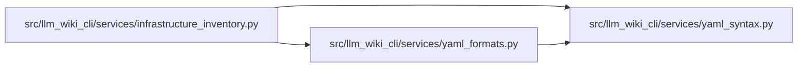

# yaml_formats Module

**Path:** `src/llm_wiki_cli/services/yaml_formats.py`

## Description

Conservative summaries for named CI, packaging, and automation YAML formats.

The caller supplies safely loaded documents. Recognition requires both an
expected repository path and the format's structural fields. Summaries contain
names and references, rather than arbitrary settings, defaults, or scripts.

The named families are GitHub action metadata, GitLab CI, CircleCI, Azure
Pipelines, Kustomize, Helm chart metadata and Ansible playbooks. Expected paths
and structural fields must agree, and multiple populated documents are not
claimed as one format. Input/output names, jobs, stages, dependencies and file
references are summaries; scripts, defaults, variable values and secret-generator
literals are omitted. Referenced files and expressions are never evaluated.

## Imports

| Source | Symbols |
|--------|---------|
| `.yaml_syntax` | `yaml_mapping`, `yaml_scalar` |
| `__future__` | `annotations` |
| `collections.abc` | `Sequence` |
| `pathlib` | `PurePosixPath` |
| `typing` | `Callable` |

## Local dependency map

<!-- Auto-generated local dependency summary. Do not edit by hand. -->

### Internal neighbors

| Direction | Module |
|---|---|
| Inbound | [infrastructure_inventory](../modules/infrastructure_inventory.md) |
| Outbound | [yaml_syntax](../modules/yaml_syntax.md) |

## Functions

| Function | Signature | Decorators | Description |
|----------|-----------|------------|-------------|
| `_items` | `(value: object) -> list` | — | — |
| `_strings` | `(value: object) -> list[str]` | — | — |
| `_names` | `(value: object) -> list[str]` | — | — |
| `_result` | `(family: str, title: str, sections: dict[str, list[str]]) -> dict` | — | — |
| `_github_action` | `(path: PurePosixPath, document: object) -> dict \| None` | — | — |
| `_gitlab_ci` | `(path: PurePosixPath, document: object) -> dict \| None` | — | — |
| `_circle_ci` | `(path: PurePosixPath, document: object) -> dict \| None` | — | — |
| `_pipeline_fields` | `(data: dict, field: str, depth: int = 0) -> list[str]` | — | — |
| `_azure_pipeline` | `(path: PurePosixPath, document: object) -> dict \| None` | — | — |
| `_kustomize` | `(path: PurePosixPath, document: object) -> dict \| None` | — | — |
| `_helm_chart` | `(path: PurePosixPath, document: object) -> dict \| None` | — | — |
| `_task_names` | `(tasks: object, depth: int = 0) -> list[str]` | — | — |
| `_ansible_playbook` | `(path: PurePosixPath, document: object) -> dict \| None` | — | — |
| `parse_extended_yaml` | `(rel_path: str, documents: Sequence[object]) -> dict \| None` | — | Recognize a single named YAML format without claiming mixed documents. |