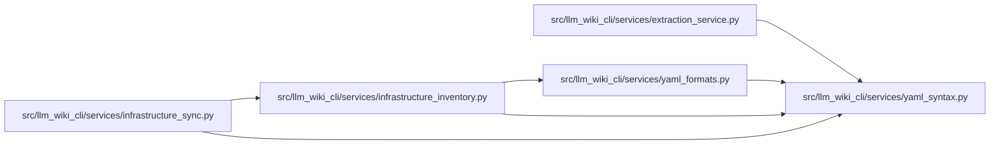

# yaml_syntax Module

**Path:** `src/llm_wiki_cli/services/yaml_syntax.py`

## Description

Bounded YAML composition for static configuration observations.

Nodes are inspected directly rather than invoking YAML constructors. Scalar
lexemes remain strings, including GitHub's unquoted ``on`` mapping key.

Composition is capped at 1 MiB of UTF-8 text, 20,000 parser events, 20,000
expanded nodes, 64 nesting levels and 128 documents. Duplicate explicit keys,
custom tags, recursive aliases and complex mapping keys reject the whole stream;
controlled advisories retain no offending source literals. Nonrecursive aliases
and mapping merges preserve first-source precedence with explicit overrides.
Empty documents are skipped, while explicit null text remains an observation.
These checks bound parsing and preserve text; they do not validate application schemas.

## Imports

| Source | Symbols |
|--------|---------|
| `__future__` | `annotations` |
| `yaml` | `yaml` |
| `yaml.events` | `CollectionEndEvent`, `CollectionStartEvent`, `DocumentStartEvent` |
| `yaml.nodes` | `MappingNode`, `Node`, `ScalarNode`, `SequenceNode` |

## Local dependency map

<!-- Auto-generated local dependency summary. Do not edit by hand. -->

### Internal neighbors

| Direction | Module |
|---|---|
| Inbound | [extraction_service](../modules/extraction_service.md) |
| Inbound | [infrastructure_inventory](../modules/infrastructure_inventory.md) |
| Inbound | [infrastructure_sync](../modules/infrastructure_sync.md) |
| Inbound | [yaml_formats](../modules/yaml_formats.md) |

### External packages

| Language | Used packages | Undeclared packages |
|---|---:|---:|
| python | 1 | 0 |

## Classes

| Class | Line | Bases | Description |
|-------|------|-------|-------------|
| [_InvalidYaml](../entities/InvalidYaml.md) | 26 | `ValueError` | An unsupported or over-budget YAML observation. |

## Functions

| Function | Signature | Decorators | Description |
|----------|-----------|------------|-------------|
| `yaml_mapping` | `(value: object) -> dict` | — | Return a composed mapping, or an empty mapping for another shape. |
| `yaml_scalar` | `(value: object) -> str` | — | Return composed scalar text without stringifying collections. |
| `load_yaml_documents` | `(text: str) -> tuple[list[object], list[str]]` | — | Compose YAML into string-keyed models, or return a qualified failure. |
| `_check_events` | `(text: str) -> None` | — | — |
| `_convert_node` | `(node: Node, active: set[int], expanded: list[int], depth: int) -> object` | — | — |
| `_convert_mapping` | `(node: MappingNode, active: set[int], expanded: list[int], depth: int) -> dict[str, object]` | — | — |
